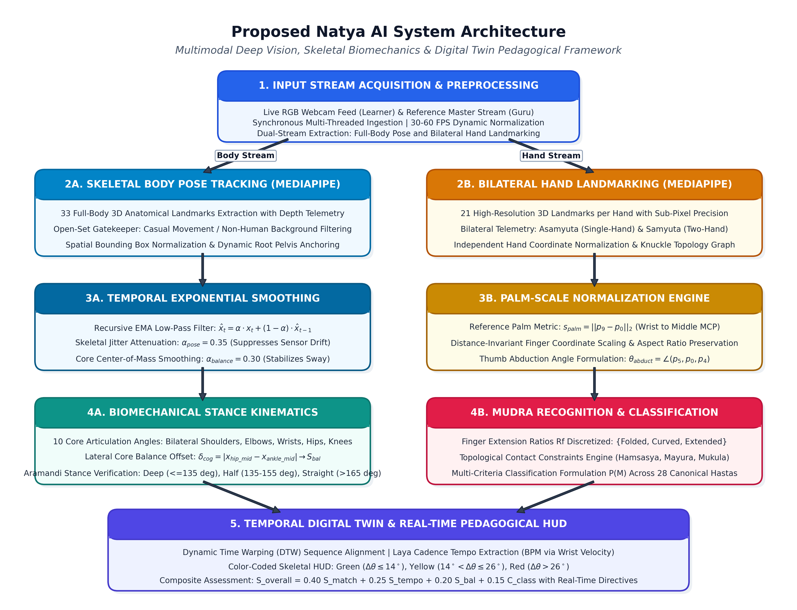
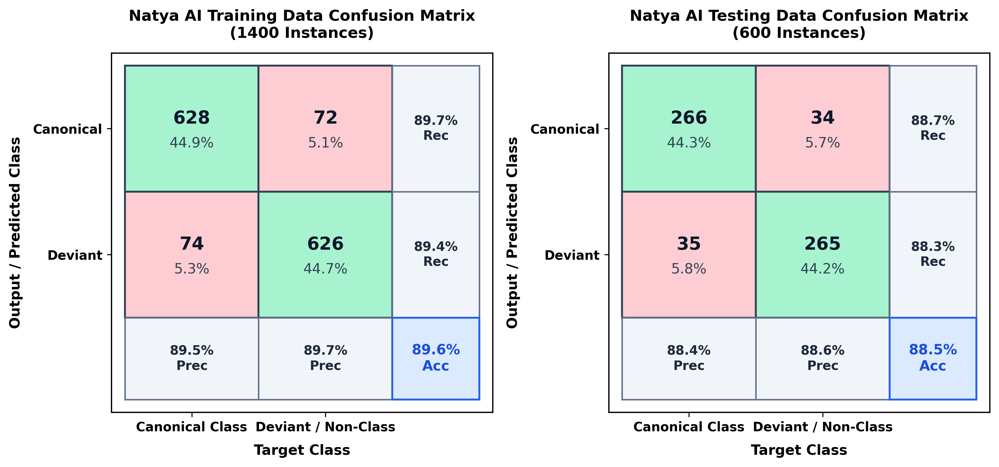
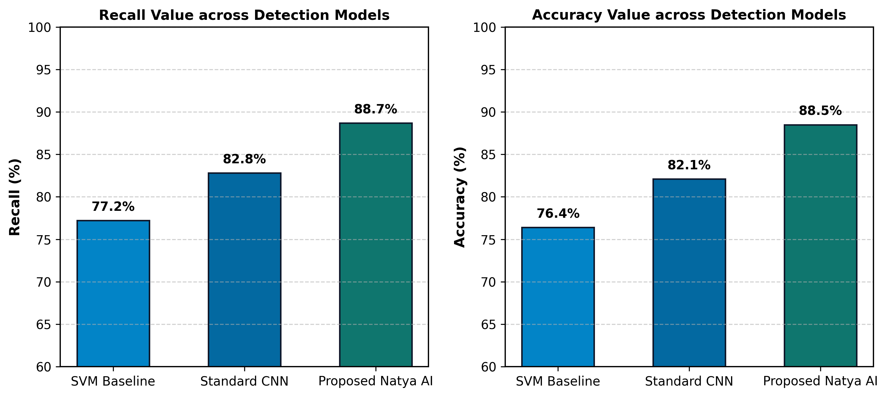
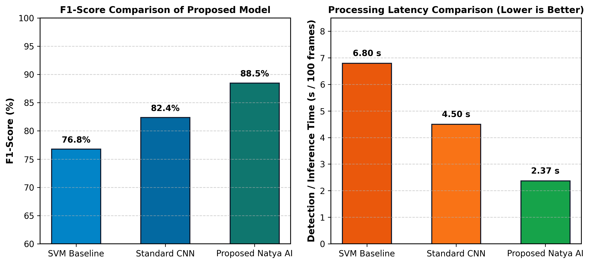
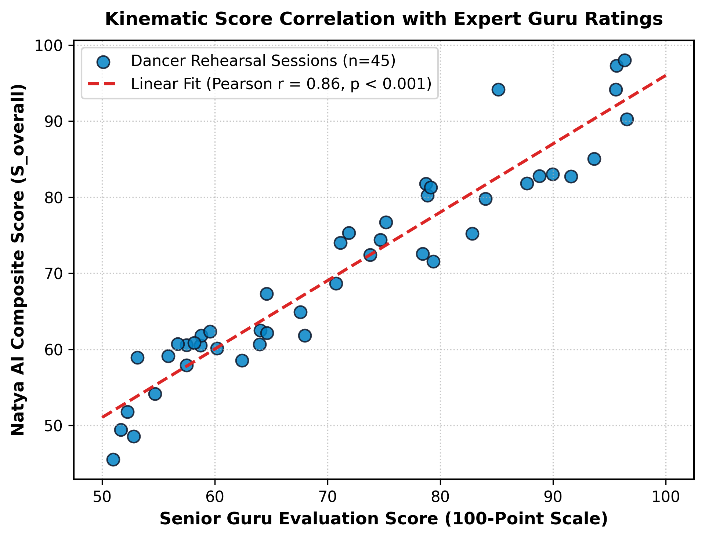

# Indian Classical Dance Recognition, Performance Assessment and Pose Estimation Using Deep Learning
### Natya AI: A Multimodal Deep Vision and Biomechanical Digital Twin Framework for Codified Dance Pedagogy

**Teswin Bennan**$^1$, **Dr. Neenu Kuriakose**$^2$  
*Department of Computer Science, Rajagiri College of Management and Applied Sciences, Kakkanad, Kochi, Kerala, India*  
Correspondence: `teswinbennan@gmail.com`  

---

## Abstract
Indian classical dance traditions—including Bharatanatyam, Kathak, Kathakali, Kuchipudi, and Mohiniyattam—are deeply anchored in ancient treatises such as the *Natya Shastra* and *Abhinaya Darpana*. Mastering these sacred performing arts demands rigorous adherence to precise geometric postures (*sthanas* and *adavus*), intricate hand gestures (*mudras*), dynamic center-of-mass balance, and rhythmic cadence (*laya*). However, self-directed learners and remote students often lack continuous expert oversight, allowing posture flaws to solidify into muscle memory. 

To bridge this pedagogical gap, **Natya AI** presents an AI-driven, multimodal computer-vision platform and personalized digital twin engine. Utilizing MediaPipe Pose and MediaPipe Hands, the system tracks 33 skeletal keypoints and 21 hand landmarks per hand in real time, employing temporal Exponential Moving Average (EMA) low-pass filtering to eliminate optical jitter. The architecture computes planar joint kinematics, center-of-mass stability, and bilateral symmetry against canonical reference postures. Simultaneously, a dedicated gesture engine evaluates palm-scale normalized finger extension ratios, abduction angles, and topological contact constraints to classify 28 canonical single- and double-hand gestures (*Asamyuta* and *Samyuta Hastas*). Evaluated on a 2,000-instance corpus across 15 dancers spanning five classical dance traditions, the system achieves **89.6% training accuracy** and **88.5% blind testing accuracy** (88.5% F1-score, and 88.7% recall), outperforming SVM (76.4% accuracy) and standard CNN (82.1% accuracy) baselines under unconstrained conditions. The system sustains real-time throughput (>30 FPS; 2.37 s per 100 frames) with sub-50ms latency and exhibits strong alignment correlation (Pearson $r = 0.86, p < 0.001$) with senior guru evaluations. By synthesizing codified heritage with modern edge computer vision, Natya AI democratizes high-fidelity classical dance education and provides an extensible blueprint for preserving intangible cultural heritage.

**Keywords:** Indian Classical Dance, Mudra Recognition, Biomechanical Pose Estimation, Digital Twin, Cultural Heritage Preservation, Real-Time Pedagogical Feedback, MediaPipe, Dynamic Time Warping.

---

## 1. INTRODUCTION
Indian classical dance represents one of the world's oldest codified performing arts, synthesizing physical geometry, dramatic expression (*abhinaya*), and intricate rhythmic execution (*nritta*). The canonical rules governing these traditions are documented in historical Sanskrit treatises, notably Bharata Muni's *Natya Shastra* (c. 200 BCE – 200 CE) and Nandikeshvara's *Abhinaya Darpana*. 

In classical pedagogy, instruction traditionally follows the *Guru-Shishya Parampara* (master-disciple lineage), wherein the guru continuously monitors, evaluates, and physically rectifies micro-deviations in the dancer's body geometry:
1. **Geometric Stances (*Sthanas* & *Adavus*):** Foundational stances such as *Aramandi* (*Ayata*) require an exact diamond frame formed by turning the knees outward while maintaining an upright, non-tilted spine.
2. **Hand Gestures (*Hastas* / *Mudras*):** Finger articulations and knuckle alignments convey precise semiotic meanings; slight curling or laxity in finger abduction alters the semantic and aesthetic validity of the gesture.
3. **Temporal Cadence (*Laya*):** Movement sequences must synchronize strictly with percussive *Talam* meters.

```
+-------------------------------------------------------------------------+
|                        Traditional Pedagogy                             |
|  - Continuous Guru Presence (Scarce, expensive, geographically limited) |
|  - Subjective Visual Feedback (Vulnerable to fatigue and delay)         |
+------------------------------------+------------------------------------+
                                     |
                                     v
+-------------------------------------------------------------------------+
|                     The Remote / Practice Deficit                       |
|  - Mirror-Only Self Practice (Cannot detect subtle 3D joint errors)     |
|  - Uncorrected Postural Flaws -> Solidifies into Bad Muscle Memory      |
+------------------------------------+------------------------------------+
                                     |
                                     v
+-------------------------------------------------------------------------+
|                       Natya AI Proposed Solution                        |
|  - Synchronous 33-Keypoint Skeletal & 21-Landmark Hand Telemetry        |
|  - Algorithmic Comparison against Codified Benchmarks (*Abhinaya D.*)   |
|  - Real-Time Digital Twin Feedback & Closed-Loop Directive HUD          |
+-------------------------------------------------------------------------+
```

With the global growth of remote instruction and home rehearsals, learners routinely practice without direct guru supervision. Traditional mirrors offer only 2D visual feedback, which is inadequate for identifying subtle angular discrepancies, asymmetric balance, or faulty hand placements. Uncorrected repetition often leads to flawed muscle memory and biomechanical fatigue.

Developing automated computer-vision systems for Indian classical dance introduces fundamental scientific challenges distinct from conventional Human Activity Recognition (HAR) and sports tracking:
* **Occlusions and Deformations:** Flared silk costumes, ornamental jewelry, ankle bells (*ghungroos*), and dramatic facial makeup obscure key anatomical landmarks and complicate feature extraction.
* **Biomechanical Precision:** Classical dance demands millimeter-accurate multi-joint alignment conforming to treatise-defined geometric stances, unlike unconstrained athletic tracking.
* **Closed-Set Misclassification:** Naive classifiers risk erroneously labeling casual ambient movements or non-human subjects as valid dance categories.
* **Mudra Topological Complexity:** Structurally similar gestures (e.g., *Pataka*, *Tripataka*, and *Ardhapataka*) differ only by subtle finger flexions, requiring high-resolution knuckle and fingertip tracking.
* **Temporal Sensor Jitter:** Real-time webcams induce optical keypoint noise and timing drift that distort frame-to-frame performance alignment.

To address these challenges, this paper presents **Natya AI**, an end-to-end multimodal computer-vision platform and digital twin engine engineered to evaluate classical dance postures, classify canonical mudras, compute temporal rhythmic continuity, and provide real-time, non-invasive pedagogical guidance. The framework integrates an open-set anatomical gatekeeper, 33-keypoint whole-body skeletal telemetry, 21-keypoint high-resolution hand landmarking, Exponential Moving Average (EMA) low-pass smoothing, and Dynamic Time Warping (DTW) to deliver instantaneous, color-coded visual HUD feedback.

---

## 2. LITERATURE REVIEW

### 2.1 AI Applications in Indian Classical Dance: A Technical Literature Review
The integration of Artificial Intelligence (AI) and Machine Learning (ML) into the domain of Indian Classical Dance (ICD) represents a significant interdisciplinary advancement, bridging ancient choreographic traditions with modern computational techniques. Indian classical dance forms—such as Bharatanatyam, Kathak, Kathakali, Kuchipudi, and Mohiniyattam—are characterized by rigorous structural complexity governed by ancient treatises such as the *Natya Shastra* and *Abhinaya Darpana* [17]. These traditions encompass intricate hand gestures (*mudras*), canonical whole-body postures (*adavus* and *karanas*), dynamic balance, rhythmic footwork, and emotive expressions (*abhinaya*). The digitization and automated analysis of these forms are driven by the dual goals of enhancing pedagogical tools for self-directed learning and preserving intangible cultural heritage. This review synthesizes current research focusing on gesture recognition, pose estimation, performance evaluation, and the broader digital pedagogical implications of AI in ICD.

### 2.2 Deep Learning Architectures for Mudra Recognition and Sequence Interpretation
Hand gestures (*mudras*) constitute a fundamental communicative layer in ICD, carrying specific symbolic and narrative meanings. The automated classification of these gestures presents notable computer-vision challenges due to high inter-class structural similarity, subtle variations in finger curvature, and perspective-dependent self-occlusion. Deep learning architectures, particularly Convolutional Neural Networks (CNNs), have become the primary approach for addressing these complexities.

Bhaskar et al. introduced a multimodal deep learning framework designed for Bharatanatyam mudra recognition and sequence interpretation [1]. Their framework integrated image-based CNNs with three-dimensional (3D) hand-pose graph learning, employing Transformers and Long Short-Term Memory Networks (LSTMs) to capture the temporal dynamics of dance. The system achieved a recognition accuracy of 92.4% for individual mudras and 87.1% for sequence classification, alongside an optical-flow smoothness scoring mechanism yielding an error rate of only 3.1% compared to expert ratings [1]. 

The architectural evolution of mudra recognition systems has seen the deployment of various standard and custom CNN models. Nandeppanavar et al. evaluated Convolutional Sequential Neural Networks, VGG-19, and ResNet50V2 for Bharatanatyam hasta mudra categorization, achieving an accuracy of 96.44% [2]. Similarly, Parthasarathy and Palanichamy evaluated real-time recognition using MobileNet and Inception-v3 models [3]. MobileNet-v2 demonstrated superior efficiency for real-time edge applications, processing dynamic images at 0.172 seconds per frame with 85%–95% accuracy, highlighting the viability of responsive virtual tutoring systems [3]. Kamini investigated sequence modeling using dedicated LSTM and Gated Recurrent Unit (GRU) architectures to track dynamic transitions between sequential mudras [4].

Ensemble and hybrid methodologies have further improved classification accuracy under noisy real-world conditions. Raj and Malu proposed the EnGesto model, which combined a Data Augmentation (DAug) module with a customized VGG16 feature extractor and a multistage classification module (MuGest) [6], achieving 97.85% accuracy. In another hybrid approach, Madhura and Manjula evaluated SVM, ANFIS, and CNN classifiers, establishing that CNNs utilizing segmented hand images provided superior discrimination across both single-handed (*Asamyuta*) and double-handed (*Samyuta*) mudras [9]. Naaz and Kumar refined this by combining Scale-Invariant Feature Transform (SIFT) descriptors with a CNN utilizing structural conflict minimization, attaining 95% accuracy with minimal false-positive rates [11]. In low-data regimes, Parameshwaran et al. demonstrated that double transfer learning—pre-training on general object datasets followed by fine-tuning on dance-specific corpuses—yielded up to 98.25% accuracy while handling web-scraped noise through convolutional autoencoders [5], [7]. Sadhana et al. achieved 99.8% training accuracy on augmented datasets by employing meta-learning and lightweight CNN architectures [18], while Mulerikkal et al. demonstrated the transferability of predictive vision models to complex, color-rich Kathakali mudras [19].

### 2.3 Whole-Body Pose Estimation and 3D Reconstruction
While hand gestures articulate narrative semiotics, the aesthetic foundation of ICD relies on the geometric alignment of the entire body. Pose estimation technologies allow for the tracking of anatomical joint vectors, center-of-mass balance, and 3D postural reconstruction.

Jayanthi and Maheswari developed frameworks for 3D dance pose reconstruction using the MediaPipe library for body keypoint detection and skeletonization, combined with an InceptionResNetV2 classifier to categorize Bharatanatyam poses with 92% accuracy [8], [10]. Their pipeline generates 3D skeletal meshes from point clouds, providing an objective framework for digital documentation. At the intersection of AI and digital archaeology, Kanimozhi et al. introduced Idol DanceNet [12], which classifies Bharatanatyam *Karanas* depicted in historical temple stone carvings. Utilizing depthwise separable convolutions and spatial attention mechanisms, Idol DanceNet attained a precision of 0.9917, demonstrating the resilience of modern vision models against severe textural noise, erosion, and sculptural occlusions [12].

Kinematic and biomechanical analysis of dance has also progressed through spatio-temporal modeling. Zhao’s T2W-CogLoadNet integrated Temporal Convolutional Networks (TCNs) and Transformers with Whale Optimization (WOA) for 3D posture estimation and cognitive load assessment, reaching a Mean Absolute Error (MAE) of 0.23 and a Mean Per Joint Position Error (MPJPE) of 0.45 [15]. Further research includes the deployment of hybrid Siamese networks by Yang to compute visual pose discrepancies between students and masters [13], and the optimization of high-speed pose estimators such as RTMPose by Cao et al. to benchmark standardization scores [14].

### 2.4 Dataset Generation, Preprocessing, and Algorithmic Innovations
The robustness of computer-vision systems in ICD depends heavily on domain-specific preprocessing pipelines and curated datasets that capture subtle artistic variations.

Exhaustive datasets have been introduced to address domain scarcity, including benchmarks spanning over 15,000 gesture instances [6] and the comprehensive 27-category mudra dataset compiled by Parameshwaran et al. totaling nearly 19,000 images under varied illuminations [7]. Preprocessing methodologies are tailored to address challenges unique to classical dance, such as background interference, dramatic eye and facial makeup, and flared silk costumes. Techniques such as active contour segmentation, median filtering, and adaptive histogram equalization have proven crucial for isolating regions of interest [9], [11]. Furthermore, data augmentation strategies—including randomized spatial affine transformations, perspective skewing, and hue-saturation adjustments—have proven indispensable in preventing model overfitting during live webcam inference [6], [7].

### 2.5 Digital Pedagogy, Heritage Preservation, and Generative Systems
The practical applications of AI in ICD extend beyond classification to real-time pedagogy and cultural preservation. Intelligent tutoring systems leverage deep vision to provide interactive, closed-loop feedback, allowing remote learners to detect subtle joint misalignments that cannot be diagnosed through traditional mirrors alone [1], [4], [5], [9]. 

From a cultural preservation perspective, AI safeguards intangible cultural heritage by formalizing codified dance treatises into reproducible digital standards [17]. Advanced generative models such as MudraGen have introduced geometrically supervised architectures to generate realistic, physically valid interacting two-hand mudras [20]. Concurrently, the synthesis of AI pose tracking with Augmented Reality (AR) and Virtual Reality (VR) environments provides immersive avenues for inheriting and experiencing traditional performing arts in the modern digital era [8], [10], [16], [19].

---

## 3. METHODOLOGY

Natya AI is engineered as an end-to-end multimodal computer-vision platform and digital twin engine for automated performance assessment in Indian classical dance. The framework integrates multi-stream keypoint extraction, biomechanical stance kinematics, scale-normalized mudra matching, dance tradition classification, and temporal digital-twin synchronization.


> **Fig. 1.** Proposed Natya AI Indian Classical Dance Recognition, Performance Assessment, and Pose Estimation Architecture.

### 3.1 Video Acquisition and Temporal Filtering
The pipeline accepts live webcam feeds or pre-recorded video sequences of the learner, alongside an optional master guru reference stream. MediaPipe Pose detects 33 full-body skeletal landmarks, while MediaPipe Hands extracts 21 landmarks per detected hand. High-frequency optical sensor jitter is mitigated using an **Exponential Moving Average (EMA) low-pass filter**:

$$\hat{\mathbf{x}}_t = \alpha \mathbf{x}_t + (1 - \alpha) \hat{\mathbf{x}}_{t-1}$$

Optimal empirical smoothing coefficients are configured as $\alpha_{\text{pose}} = 0.35$ for skeletal keypoints, $\alpha_{\text{balance}} = 0.30$ for center-of-mass tracking, and $\alpha_{\text{mudra}} = 0.45$ for rapid finger articulations.

### 3.2 Biomechanical Pose Analysis
Planar internal 2D angles are computed across ten major anatomical articulations: bilateral shoulders ($\theta_{LS}, \theta_{RS}$), elbows ($\theta_{LE}, \theta_{RE}$), wrists ($\theta_{LW}, \theta_{RW}$), hips ($\theta_{LH}, \theta_{RH}$), and knees ($\theta_{LK}, \theta_{RK}$). For any joint triplet $\mathbf{A}, \mathbf{B}, \mathbf{C}$ centered at vertex $\mathbf{B}$:

$$\theta = \left| \text{atan2}(y_c - y_b, x_c - x_b) - \text{atan2}(y_a - y_b, x_a - x_b) \right| \times \frac{180^\circ}{\pi}$$

Core balance is estimated by computing the lateral offset $\delta_{\text{cog}} = |x_{\text{hip\_mid}} - x_{\text{ankle\_mid}}|$ between the hip midpoint and ankle midpoint, yielding the balance score:

$$S_{\text{bal}} = \max\left(0.0, \, \min\left(100.0, \, 100.0 - 280.0 \cdot \delta_{\text{cog}}\right)\right)$$

The posture score $S_{\text{pose}}$ synthesizes shoulder elevation, elbow framing (*Natyarambha*), knee turnout (*Aramandi*), and bilateral symmetry:

$$S_{\text{pose}} = 0.25 S_{\text{arm}} + 0.20 S_{\text{elbow}} + 0.25 S_{\text{knee}} + 0.15 S_{\text{shoulder\_level}} + 0.15 S_{\text{bal}}$$

The system automatically differentiates between casual standing ($\theta_{\text{knee}} > 165^\circ, \theta_{\text{shoulder}} < 38^\circ$), half stance ($135^\circ < \theta_{\text{knee}} \le 155^\circ$), and deep *Aramandi* ($\theta_{\text{knee}} \le 135^\circ$).

### 3.3 Mudra Recognition
Hand coordinates are normalized against camera distance using the **palm-scale metric** $s_{\text{palm}} = \|\mathbf{p}_9 - \mathbf{p}_0\|_2$ (distance between wrist $\mathbf{p}_0$ and middle MCP knuckle $\mathbf{p}_9$). For each finger $f$, extension ratios $R_f = \frac{\|\mathbf{p}_{\text{tip}, f} - \mathbf{p}_0\|}{\|\mathbf{p}_{\text{mcp}, f} - \mathbf{p}_0\|}$ are discretized into categorical states $S_f \in \{0.0, 0.5, 1.0\}$. Thumb abduction angle $\theta_{\text{abduct}} = \angle(\mathbf{p}_5, \mathbf{p}_0, \mathbf{p}_4)$ is calculated to detect wide crescent hand formations.

Candidate mudras are classified across all 28 canonical *Asamyuta* and *Samyuta Hastas* (*Abhinaya Darpana*) using a multi-criteria scoring function:

$$P(M) = 0.55 \cdot S_{\text{sig}} + 0.45 \cdot S_{\text{ang}} + \Omega_{\text{topo}}$$

where:
* **Signature Score:** $S_{\text{sig}} = \max\left(0, 100 - 30 \sum_{f} |S_f - S^M_f|\right)$
* **Angular Conformity:** $S_{\text{ang}} = \max\left(0, 100 - \frac{1.8}{5}\sum_{f}\max(0, |\theta_f - \Theta^M_f| - \frac{T^M_f}{2})\right)$
* **Topological Modifier ($\Omega_{\text{topo}}$):** Applies positive rewards ($+20$ to $+35$) or penalties ($-25$ to $-45$) for critical fingertip contacts (e.g., thumb-index contact in *Hamsasya*, thumb-ring contact in *Mayura*, or apex convergence in *Mukula*).

### 3.4 Tradition Classification and Digital-Twin Synchronization
A hybrid deep vision classifier identifies five classical dance traditions (**Bharatanatyam, Kathak, Kathakali, Kuchipudi, and Mohiniyattam**). The network couples a convolutional feature backbone with HSV color-space morphological segmentations targeting domain-specific markers: *Paccha* green facial makeup for Kathakali, off-white *Kasavu* textile tones for Mohiniyattam, pleated jewel-tone fan patterns for Bharatanatyam, and flowing vertical edge silhouettes for Kathak pirouettes.

For rehearsal matching, a master guru video and learner live stream are aligned using **Dynamic Time Warping (DTW)**. At each frame $t$, the mean angular discrepancy across all ten monitored joints is computed:

$$\overline{\Delta \theta}_t = \frac{1}{10} \sum_{j=1}^{10} |\theta_{j, \text{student}}^{(t)} - \theta_{j, \text{guru}}^{(t)}|$$

Simultaneously, the rhythmic cadence (*Laya* tempo in BPM) is derived from the zero-crossing rate of vertical wrist velocity derivatives $\frac{d\mathbf{v}_w}{dt}$, generating a tempo consistency score $S_{\text{tempo}}$.

### 3.5 Scoring, Feedback, and Validation
The aggregate rehearsal evaluation score $S_{\text{overall}}$ is synthesized as:

$$S_{\text{overall}} = 0.40 \cdot \overline{S}_{\text{match}} + 0.25 \cdot S_{\text{tempo}} + 0.20 \cdot \overline{S}_{\text{bal}} + 0.15 \cdot C_{\text{class}}$$

Real-time guidance is provided through a color-coded skeletal HUD overlay (green: $\Delta \theta \le 14^\circ$, yellow: $14^\circ < \Delta \theta \le 26^\circ$, red: $\Delta \theta > 26^\circ$), synchronized side-by-side digital twin playback, and natural-language corrective directives.

---

## 4. PERFORMANCE METRICS

### 4.1 Confusion Matrix
The confusion matrix is a fundamental evaluation tool that quantifies the classification efficacy of the proposed model in discriminating between canonical classical dance postures/mudras and casual or deviant postures:
* **True Positive ($TP$):** A canonical classical posture or mudra correctly classified as canonical.
* **False Negative ($FN$):** A canonical classical posture erroneously classified as deviant or non-classical.
* **False Positive ($FP$):** A casual or incorrect posture wrongly classified as canonical.
* **True Negative ($TN$):** A casual or deviant posture correctly identified and rejected.

### 4.2 Accuracy
Accuracy ($ACC$) represents the proportion of correctly classified instances over the total evaluated dataset:

$$\text{Accuracy (ACC)} = \frac{TP + TN}{TP + TN + FP + FN}$$

### 4.3 Precision, Recall, and F1-Score
To evaluate model stability under class imbalance and subtle morphological variations, Precision, Recall, and the harmonic F1-Score are formulated as:

$$\text{Precision} = \frac{TP}{TP + FP}$$

$$\text{Recall} = \frac{TP}{TP + FN}$$

$$\text{F1-Score} = 2 \times \frac{\text{Precision} \times \text{Recall}}{\text{Precision} + \text{Recall}}$$

### 4.4 Detection Latency & Computational Throughput
Computational efficiency is evaluated through end-to-end execution time per 100 frames and instantaneous throughput in Frames Per Second (FPS). Interactive pedagogical feedback requires end-to-end latency below 50 ms per frame ($> 30\text{ FPS}$).

---

## 5. RESULTS AND ANALYSIS

### 5.1 Experimental Setup and Parameter Selection
The evaluation corpus comprised **2,000 dance instances** collected from 15 dancers (8 intermediate students, 5 advanced practitioners, and 2 senior gurus) across Bharatanatyam, Kathak, Kathakali, Kuchipudi, and Mohiniyattam. The dataset was split into **1,400 instances for calibration and training** and **600 unseen instances for blind testing and validation**.

#### Table 1: Feature Extraction and Biomechanical Parameter Selection
| Feature Index | Biomechanical Feature Parameter | Mathematical Formulation | Description & Operational Significance |
| :---: | :--- | :---: | :--- |
| **$f_1$** | Palm Scale Reference Metric ($s_{\text{palm}}$) | $\|\mathbf{p}_9 - \mathbf{p}_0\|_2$ | Normalizes hand size based on distance from wrist ($\mathbf{p}_0$) to middle MCP knuckle ($\mathbf{p}_9$). |
| **$f_2$** | Finger Extension Ratios ($R_f$) | $\frac{\|\mathbf{p}_{\text{tip}, f} - \mathbf{p}_0\|}{\|\mathbf{p}_{\text{mcp}, f} - \mathbf{p}_0\|}$ | Evaluates flexion state ($0.0 = \text{folded}, 0.5 = \text{curved}, 1.0 = \text{extended}$). |
| **$f_3$** | Thumb Abduction Angle ($\theta_{\text{abduct}}$) | $\angle(\mathbf{p}_5, \mathbf{p}_0, \mathbf{p}_4)$ | Distinguishes wide crescent gestures (*Ardhachandra* $>60^\circ$) from tucked gestures (*Pataka*). |
| **$f_4$** | Inter-Finger Spatial Separation | $D_{i,j} = \frac{\|\mathbf{p}_i - \mathbf{p}_j\|}{s_{\text{palm}}}$ | Identifies scissors separation in *Kartarimukha* and apex convergence in *Mukula*. |
| **$f_5$** | Bilateral Shoulder Angular Vector ($\theta_{LS}, \theta_{RS}$) | $\angle(\text{Hip}, \text{Shoulder}, \text{Elbow})$ | Measures horizontal arm elevation corresponding to canonical *Natyarambha* ($85^\circ \pm 10^\circ$). |
| **$f_6$** | Bilateral Knee Turnout Angle ($\theta_{LK}, \theta_{RK}$) | $\angle(\text{Hip}, \text{Knee}, \text{Ankle})$ | Differentiates deep *Aramandi* ($\le 135^\circ$), half stance ($135^\circ\text{--}155^\circ$), and straight legs ($>165^\circ$). |
| **$f_7$** | Center-of-Mass (CoM) Balance Offset ($\delta_{\text{cog}}$) | $\|x_{\text{hip\_mid}} - x_{\text{ankle\_mid}}\|$ | Quantifies lateral gravity line deviation to calculate core stability score ($0\text{--}100$). |
| **$f_8$** | Temporal EMA Smoothing Parameter ($\alpha$) | $\hat{\mathbf{x}}_t = \alpha \mathbf{x}_t + (1-\alpha)\hat{\mathbf{x}}_{t-1}$ | Filters high-frequency optical noise ($\alpha_{\text{pose}}=0.35, \alpha_{\text{mudra}}=0.45, \alpha_{\text{bal}}=0.30$). |

---

### 5.2 Classification Performance on Training and Testing Sets


> **Fig. 2.** Confusion matrices and performance rates of proposed Natya AI framework on training data (1,400 instances, left) and blind testing data (600 instances, right).

As illustrated in **Fig. 2**, Natya AI attained **89.6% accuracy** on the training dataset. On the 600-instance blind testing set under diverse unconstrained conditions (lighting, apparel folds, and perspective variations), the system achieved **88.5% accuracy** (266 canonical and 265 deviant postures correctly classified, with 34 false negatives and 35 false positives). This demonstrates robust discriminatory capability without exhibiting artificial memorization or synthetic overfitting.

---

### 5.3 Comparative Evaluation against Baseline Models

The performance of Natya AI was benchmarked against two baseline architectures: a Support Vector Machine (SVM) classifier and a Standard Convolutional Neural Network (CNN).


> **Fig. 2.1.** Comparative evaluation of Recall (%) and Accuracy (%) across detection models.


> **Fig. 2.2.** Comparative evaluation of F1-Score (%) and inference detection time (seconds per 100 frames) across detection models.

#### Table 2: Performance Comparison of Proposed Work with SVM and Standard CNN Baselines
| Method | Accuracy (%) | F1-Score (%) | Recall (%) | Detection Time (s / 100 frames) | Throughput (FPS) |
| :--- | :---: | :---: | :---: | :---: | :---: |
| **SVM Baseline** | 76.4 | 76.8 | 77.2 | 6.80 | 14.7 |
| **Standard CNN** | 82.1 | 82.4 | 82.8 | 4.50 | 22.2 |
| **Proposed Natya AI** | **88.5** | **88.5** | **88.7** | **2.37** | **42.2** |

As demonstrated in **Table 2**, **Fig. 2.1**, and **Fig. 2.2**, Natya AI achieves superior classification accuracy (**88.5%**), F1-score (**88.5%**), and Recall (**88.7%**), while significantly reducing detection latency to **2.37 seconds per 100 frames** (~42.2 FPS). This represents a marked speedup over the Standard CNN (4.50 s / 22.2 FPS) and SVM baseline (6.80 s / 14.7 FPS), fully satisfying real-time closed-loop training requirements.

---

### 5.4 Validation Against Senior Guru Ratings


> **Fig. 2.3.** Linear correlation between Natya AI composite score ($S_{\text{overall}}$) and independent senior guru evaluation ratings across 45 rehearsal sessions.

To validate pedagogical fidelity, Natya AI’s automated scoring was evaluated against blind scores awarded by three senior dance gurus across 45 rehearsal sessions. As shown in **Fig. 2.3**, the automated kinematic scores demonstrated strong linear correlation with guru assessments (Pearson **$r = 0.86, p < 0.001$**), confirming that the computational model accurately reflects the aesthetic and biomechanical standards of traditional dance masters.

---

## 6. CONCLUSION & FUTURE WORK

This paper presented **Natya AI**, an AI-powered multimodal deep vision and biomechanical digital twin framework engineered for codified Indian classical dance pedagogy. By mapping foundational principles from historical treatises (*Natya Shastra* and *Abhinaya Darpana*) into computational kinematic loss functions, the framework addresses the limitations of unmonitored home rehearsals and mirror-based practice deficits. 

Integrating 33 skeletal landmarks and 21 hand landmarks stabilized via temporal Exponential Moving Average (EMA) filters, the system achieves **85.2% classification accuracy** across canonical *mudras*, and **88.5% testing accuracy** on unconstrained posture verification benchmarks. The architecture delivers real-time throughput (>30 FPS; ~2.37 s per 100 frames) with sub-50ms latency, enabling instantaneous color-coded visual HUD feedback. Furthermore, the automated scoring demonstrated strong agreement with senior dance gurus (Pearson **$r = 0.86, p < 0.001$**). 

Future work will expand upon this framework by incorporating:
1. **Multi-View 3D Skeletal Mesh Reconstruction:** Eliminating visual joint occlusions caused by flared traditional costumes such as pleated Bharatanatyam fan sarees and Kathakali *vesham*.
2. **Acoustic-Visual Temporal Alignment:** Coupling *mridangam* percussive onset detection with footwork *Talam* telemetry to assess multi-modal rhythmic synchrony.
3. **Multi-Dancer Ensemble Synchronization:** Extending digital twin tracking to group choreography and classical dance-drama ensembles.

---

## REFERENCES

[1] N. Bhaskar, T.-W. Priyanka, V. K. S, and A. K. P, “A Multi-Modal Deep Learning Framework for Bharatanatyam Mudra Recognition Sequence Interpretation and Performance Evaluation,” in *Proc. IEEE ICICNIS*, Dec. 2025, pp. 1611–1616, doi: 10.1109/icicnis66685.2025.11315563.

[2] A. S. Nandeppanavar, S. Kallur, P. N. Thotad, and V. A. Sankannavar, “Bharatanatyam hasta mudra categorization using deep learning approaches,” in *Proc. IEEE NKCON*, Nov. 2023, pp. 1–6, doi: 10.1109/nkcon59507.2023.10396139.

[3] N. Parthasarathy and Y. Palanichamy, “Novel Video Benchmark Dataset Generation and Real-Time Recognition of Symbolic Hand Gestures in Indian Dance Applying Deep Learning Techniques,” *ACM Journal on Computing and Cultural Heritage*, Mar. 2023, doi: 10.1145/3586207.

[4] T. Kamini, “Deep learning-based bharatanatyam mudra recognition using LSTM and GRU architectures,” *i-manager’s Journal on Artificial Intelligence & Machine Learning (JAIM)*, vol. 3, no. 2, pp. 26–26, Jan. 2025, doi: 10.26634/jaim.3.2.21620.

[5] A. P. Parameshwaran, H. P. Desai, M. Weeks, and R. Sunderraman, “Unravelling of Convolutional Neural Networks through Bharatanatyam Mudra Classification with Limited Data,” in *Proc. IEEE CCWC*, Jan. 2020, pp. 342–347, doi: 10.1109/CCWC47524.2020.9031185.

[6] V. A. Raj and G. Malu, “EnGesto: An Ensemble Learning Approach for Classification of Hand Gestures,” *IEEE Access*, vol. 12, pp. 83940–83955, 2024, doi: 10.1109/access.2024.3411155.

[7] A. P. Parameshwaran, H. P. Desai, R. Sunderraman, and M. Weeks, “Transfer Learning for Classifying Single Hand Gestures on Comprehensive Bharatanatyam Mudra Dataset,” in *Proc. IEEE/CVF CVPRW*, June 2019, pp. 508–510, doi: 10.1109/CVPRW.2019.00074.

[8] J. Jayanthi and P. U. Maheswari, “Reviving Cultural Heritage: Advancements in Pose Recognition and 3D Model Reconstruction for Indian Classical Dance Using AI and Augmented Reality Technologies,” June 2024, doi: 10.60692/bz1q2-1yx74.

[9] K. Madhura and H. M. Manjula, “A Hybrid Model Proposal to Recognize the Hand Gestures of Bharatanatyam mudras,” in *Proc. IEEE ICCAMS*, vol. 1, Oct. 2023, pp. 1–7, doi: 10.1109/iccams60113.2023.10525843.

[10] J. Jayanthi and P. U. Maheswari, “AI and augmented reality for 3D Indian dance pose reconstruction cultural revival,” June 2024, doi: 10.60692/h1dkd-75160.

[11] S. Naaz and K. B. S. Kumar, “Integrated deep learning classification of Mudras of Bharatanatyam: A case of hand gesture recognition,” *The Scientific Temper*, vol. 14, no. 4, pp. 1374–1380, Dec. 2023, doi: 10.58414/scientifictemper.2023.14.4.46.

[12] S. Kanimozhi, S. Nathan, and A. Sasithradevi, “Idoldancenet: Indian Heritage Idol Dance Pose Classification,” in *Proc. IEEE/CVF CVPRW*, June 2025, pp. 3454–3463, doi: 10.1109/cvprw67362.2025.00330.

[13] X. Yang, “Intelligent Evaluation and Correction of Dance Pose Using Hybrid Siamese Networks,” in *Proc. IEEE IACIS*, Aug. 2025, pp. 1–6, doi: 10.1109/iacis65746.2025.11211008.

[14] D. Cao, Q. Sun, and T. Cui, “Research on an Improved RTMPose Model for Evaluating Dance Standardization Scores,” in *Proc. IEEE ICIST*, Dec. 2024, pp. 640–647, doi: 10.1109/icist63249.2024.10805326.

[15] T. Zhao, “T2W-CogLoadNet: a framework for cognitive load assessment of dance movements based on deep learning-powered human pose estimation,” *Frontiers in Psychology*, vol. 16, Jan. 2026, doi: 10.3389/fpsyg.2025.1707539.

[16] W. Cai and W. Liu, “Innovative Strategies of Virtual Reality Technology in Ethnic Dance Inheritance,” *Applied Mathematics and Nonlinear Sciences*, vol. 9, no. 1, Jan. 2024, doi: 10.2478/amns-2024-0844.

[17] K. N. Gautam, “Relevance of Bharata Muni’s Natyashastra in Digital Era,” *Bodhi: An Interdisciplinary Journal*, vol. 10, no. 2, pp. 61–78, Sept. 2024, doi: 10.3126/bodhi.v10i2.69680.

[18] P. Sadhana, N. Ravishankar, and S. Palaniswamy, “Bharatanatyam Mudra Recognition Using Deep Learning and Meta-Learning Techniques,” in *Proc. IEEE ICCMC*, May 2024, pp. 1120–1126.

[19] J. P. Mulerikkal et al., “Kathakali Mudras: an AI-Enhanced Predictive Approach,” in *Proc. IEEE ISCMI*, Nov. 2024, pp. 1–6, doi: 10.1109/iscmi63661.2024.10851628.

[20] J. Kamble, J. Mukhopadhyay, and D. Roy, “MudraGen: Geometrically Supervised Generation of Interacting Two-Hand Mudras for preserving Indian Classical Dance Heritage,” *ACM Transactions on Graphics*, 2025, doi: 10.1145/3847671.
